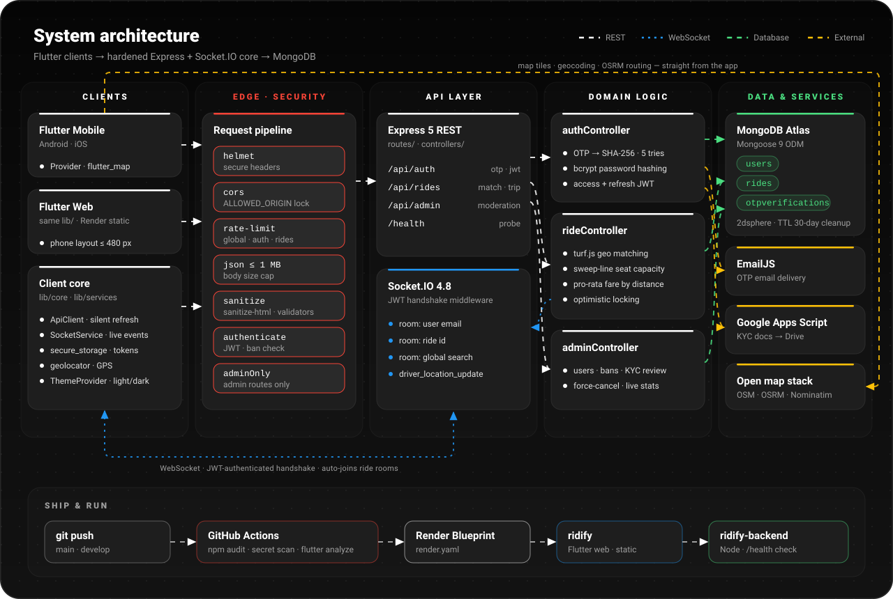

<div align="center">


<br/>

[](https://ridify.onrender.com)

[](https://flutter.dev)
[](https://dart.dev)
[](https://nodejs.org)
[](https://expressjs.com)
[](https://www.mongodb.com)
[](https://socket.io)
[](LICENSE)

**[Features](#-features)** &nbsp;·&nbsp; **[Architecture](#-architecture)** &nbsp;·&nbsp; **[How it works](#-how-it-works)** &nbsp;·&nbsp; **[Tech stack](#-tech-stack)** &nbsp;·&nbsp; **[Getting started](#-getting-started)**

</div>


<div align="center">
  
</div>

## 🚗 What is Ridify?

**Ridify is a real-time, peer-to-peer ride-sharing app.** Drivers who are already making a trip offer their empty seats. Riders going the same way book those seats and pay only for the part of the route they ride.

Every ride is live. Drivers stream GPS over WebSockets, riders watch the car approach on the map, and everyone in the car shares a chat. Each step of the trip (request, accept, arrive, board, drop off, pay) is checked by the server and pushed to every phone instantly.

One Flutter codebase runs on **Android, iOS and the web**. It talks to a **Node.js + Express 5 + Socket.IO** backend on **MongoDB**, with an admin panel for moderation and KYC.

<br/>


## ✨ Features

<table>
<tr>
<td width="50%" valign="top">

### 🗺️ Live tracking
Drivers stream their position over Socket.IO. Riders see the car move on an OpenStreetMap view with the route drawn in, from booking to drop-off.

</td>
<td width="50%" valign="top">

### 🧮 Smart seat matching
Rides are matched by how close pickup and drop-off are to the driver's route, using **turf.js**. A **sweep-line** check makes sure no part of the route is ever over capacity.

</td>
</tr>
<tr>
<td valign="top">

### 💰 Fair, distance-based fares
Each rider pays for **their own slice of the route**, not an equal share. The server recalculates every fare, so the client can't change the price.

</td>
<td valign="top">

### 💬 In-ride chat
Each ride gets its own chat room for the driver and all co-passengers, with swipe-to-reply threads and messages delivered in real time.

</td>
</tr>
<tr>
<td valign="top">

### 🔐 OTP + JWT auth
Sign-up and login are verified by an email OTP (stored as a SHA-256 hash, 5 tries max). Passwords use bcrypt. The app keeps you signed in with access and refresh tokens and refreshes them silently.

</td>
<td valign="top">

### 🚦 Full ride lifecycle
`available → accepted → full → started → completed`, plus a separate per-passenger flow: request, accept, arrive, board, drop off, pay. Every transition uses optimistic locking.

</td>
</tr>
<tr>
<td valign="top">

### 🛡️ Admin & KYC
A dashboard with live stats, user management, bans, force-cancel, and review of driver ID documents (uploaded to Google Drive through Apps Script).

</td>
<td valign="top">

### 🌗 Light & dark, phone & web
A monochrome Material theme in both modes. The same `lib/` builds for Android, iOS and a Render-hosted web app.

</td>
</tr>
</table>


## 🏗️ Architecture

<div align="center">
  
</div>

<br/>

| Layer | What lives there |
|---|---|
| **Clients** | Flutter app (`frontend/`) with `Provider` state, `ApiClient` (auto-retries after a silent token refresh), `SocketService`, `flutter_secure_storage` and `geolocator`. The web build (`web-app/`) compiles the same `lib/`. |
| **Edge** | `helmet`, a locked-down CORS origin, three rate limiters (global 200 req/min, plus stricter auth and ride limiters), a 1 MB JSON cap, `sanitize-html`, the JWT `authenticate` middleware (with a ban check) and an `adminOnly` guard. |
| **API** | Express 5 routers for `/api/auth`, `/api/rides` and `/api/admin`, plus `/health`. Socket.IO authenticates the JWT during the handshake and auto-joins user, ride and global-search rooms. |
| **Domain** | Controllers for auth, rides and admin. Geo maths uses `@turf/turf`, seat capacity uses the sweep-line helpers in `utils/rideHelpers.js`, and `winston` handles logging. |
| **Data & services** | MongoDB (`users`, `rides`, `otpverifications`) with a `2dsphere` index and a 30-day TTL on finished rides. EmailJS sends OTPs and Google Apps Script stores KYC documents. OSM tiles, OSRM and Nominatim are called directly from the app. |


## ⚙️ How it works

### The life of a ride

<div align="center">
  
</div>

<br/>

Every step is a guarded `PATCH` on `/api/rides/...`. The controller checks the current state and who is asking, writes the change with an optimistic lock, and then emits to the ride's room:

| Step | Endpoint | Socket.IO event |
|---|---|---|
| Driver offers a ride | `POST /api/rides` | — |
| Rider requests seats | `PATCH /request/:id` | `new_ride_request` |
| Driver accepts / declines / removes | `PATCH /accept` · `/decline` · `/kick` | `ride_updated` · `passenger_kicked` |
| Driver starts the trip | `PATCH /start/:id` | `ride_started` |
| Live position | socket `driver_location_update` | `driver_location_update` |
| Arrive → board → drop off → pay | `PATCH /arrive` · `/board` · `/dropoff` · `/pay` | `driver_arrived` · `passenger_boarded` · `passenger_dropped` · `passenger_paid` |
| Trip ends | `PATCH /end/:id` | `ride_ended` |
| Chat | `POST /:id/chat` | `receive_message` |

### Sweep-line seat capacity

<div align="center">
  
</div>

<br/>

A car with 4 seats can carry far more than 4 riders on one trip if they ride different stretches of it. Ridify turns every accepted booking into two events on the route, **+seats at pickup** and **−seats at drop-off**. It sorts them by route index (with drop-offs before pick-ups at the same index) and sweeps across them, tracking the running total. The request is accepted only if the peak stays within `totalSeats`.

```js
changes.sort((a, b) => a.index - b.index || a.change - b.change);   // drop-offs first
let current = 0, peak = 0;
for (const c of changes) { current += c.change; peak = Math.max(peak, current); }
return peak <= ride.totalSeats;
```

### Fair fares

Each rider's fare is worked out **on the server** from the part of the driver's route they actually ride:

```
rider fare = ride fare × (rider's segment distance ÷ total route distance)
```

So a rider covering 40% of a ₹200 trip pays **₹80**. Anyone riding 99% or more pays the full fare, which avoids rounding losses.

### Authentication flow

<div align="center">
  
</div>


## 🧰 Tech stack

<div align="center">
  
</div>

<br/>

<table>
<tr>
<th width="33%">📱 Frontend</th>
<th width="33%">⚙️ Backend</th>
<th width="33%">🌐 Services</th>
</tr>
<tr>
<td valign="top">

- **Flutter** · Dart 3
- `provider`: state
- `socket_io_client`: realtime
- `flutter_map` + `latlong2`: maps
- `geolocator`: GPS
- `flutter_secure_storage`: tokens
- `image_picker`: KYC uploads
- `http`: REST

</td>
<td valign="top">

- **Node.js** · **Express 5**
- **MongoDB** · Mongoose 9
- **Socket.IO** 4.8
- `jsonwebtoken` · `bcrypt`
- `@turf/turf`: geo maths
- `helmet` · `express-rate-limit`
- `sanitize-html` · `winston`
- `jest` · `supertest`

</td>
<td valign="top">

- **Render**: API + static web
- **MongoDB Atlas**: database
- **EmailJS**: OTP email
- **Google Apps Script**: KYC
- **OSRM**: routing
- **Nominatim**: geocoding
- **OpenStreetMap**: tiles
- **GitHub Actions**: CI

</td>
</tr>
</table>


## 🚀 Getting started

> **Prerequisites:** Node.js 20+, Flutter 3.x (Dart ≥ 3.11), a MongoDB database (local or [Atlas](https://www.mongodb.com/atlas)), and an Android/iOS device or emulator.

**1. Clone**

```bash
git clone https://github.com/Hackotber-26/T06-HopSync.git
cd ridify
```

**2. Backend**

```bash
cd backend
npm install
cp .env.example .env     # fill in the values below
npm run dev              # validates env, then starts on http://localhost:5001
```

**3. Frontend**

```bash
cd frontend
cp .env.example .env     # BACKEND_URL=http://10.0.2.2:5001 for the Android emulator
flutter pub get
flutter run
```

> 💡 On a physical phone, point `BACKEND_URL` at your computer's LAN IP. For release builds, pass it in with `--dart-define=BACKEND_URL=https://your-api.example.com`.

<details>
<summary><b>🔧 Backend environment variables</b></summary>

<br/>

| Variable | Required | Description |
|---|:---:|---|
| `PORT` | | HTTP port (default `5001`) |
| `MONGO_URI` | ✅ | MongoDB connection string |
| `JWT_SECRET` | ✅ | Access-token secret (64-byte hex) |
| `JWT_REFRESH_SECRET` | ✅ | Refresh-token secret, different from the above |
| `JWT_EXPIRES_IN` / `JWT_REFRESH_EXPIRES_IN` | | Token lifetimes (default `24h` / `7d`) |
| `ADMIN_EMAILS` | ✅ | Comma-separated admin accounts |
| `ADMIN_SECRET` | ✅ | Secret for admin operations |
| `ALLOWED_ORIGIN` | ✅ | CORS + Socket.IO origin (`*` for mobile-only) |
| `EMAILJS_SERVICE_ID` · `EMAILJS_TEMPLATE_ID` · `EMAILJS_PUBLIC_KEY` · `EMAILJS_PRIVATE_KEY` | ✅ | OTP email delivery |
| `GOOGLE_APPS_SCRIPT_URL` | ✅ | Apps Script endpoint for KYC uploads |
| `ALLOWED_EMAIL_DOMAIN` | | Limit sign-ups to one email domain |
| `BCRYPT_ROUNDS` · `MAX_FARE` · `SEARCH_RADIUS_DEFAULT_M` · `MIN_RIDE_DISTANCE_KM` … | | Tuning knobs, see `backend/.env.example` |

Generate a secret with:

```bash
node -e "console.log(require('crypto').randomBytes(64).toString('hex'))"
```

</details>

<details>
<summary><b>☁️ Deploy to Render (one blueprint)</b></summary>

<br/>

The root [`render.yaml`](render.yaml) sets up both services on Render's free tier:

| Service | Type | What it does |
|---|---|---|
| `ridify-backend` | Node web service | `npm ci` → `npm start`, health-checked on `/health` |
| `ridify` | Static site | `bash web-app/build.sh` compiles the Flutter web app against `BACKEND_URL` |

In Render, choose **New → Blueprint**, connect this repo, fill in the secret env vars, and set `ALLOWED_ORIGIN` on the backend to the static site's URL. See [`web-app/README.md`](web-app/README.md) for details.

</details>

<details>
<summary><b>📡 REST API reference</b></summary>

<br/>

| Area | Method & path | Purpose |
|---|---|---|
| Auth | `POST /api/auth/signup-otp-request` · `/register` | Email OTP sign-up |
| | `POST /api/auth/login` · `/login-otp-request` | Password or OTP login |
| | `POST /api/auth/refresh` · `/logout` | Token refresh / sign out |
| | `PATCH /api/auth/change-password` | Change password |
| | `GET /api/auth/user/:email/profile` · `POST /user/:email/upload-id` | Profile · KYC upload |
| Rides | `GET /api/rides/search` | Route-aware search |
| | `POST /api/rides` · `GET /api/rides/:id` | Offer / fetch a ride |
| | `PATCH /request` `/accept` `/decline` `/kick` `/arrive` `/board` `/dropoff` `/pay` `/start` `/end` `/cancel` | Lifecycle |
| | `POST /api/rides/:id/chat` | In-ride message |
| | `GET /api/rides/stats/driver` | Driver earnings |
| Admin | `GET /api/admin/stats` · `/users` · `/rides` · `/verifications/pending` | Dashboard data |
| | `POST /users/:id/ban` · `/unban` · `PATCH /users/:id/verify` · `/reject-verification` | Moderation & KYC |
| | `PATCH /rides/:id/cancel` · `DELETE /rides/:id` | Ride control |

</details>

<details>
<summary><b>🗂️ Project structure</b></summary>

<br/>

```
ridify/
├── backend/                 Node.js + Express 5 + Socket.IO API
│   ├── config/              db.js · socket.js (JWT handshake, rooms)
│   ├── controllers/         auth · ride · admin
│   ├── middleware/          authenticate · adminOnly
│   ├── models/              user · ride · OtpVerification
│   ├── routes/              /api/auth · /api/rides · /api/admin
│   └── utils/               rideHelpers (sweep-line) · jwt · otp · logger · validators
├── frontend/                Flutter app (Android · iOS · desktop)
│   └── lib/
│       ├── core/            theme · providers · socket_service · constants
│       ├── screens/         home · find/offer · live tracking · chat · admin …
│       ├── services/        api_client · auth · ride · location · nominatim …
│       └── widgets/         swipe_to_reply · address_search · verified_badge …
├── web-app/                 isolated Flutter-web build for Render
├── render.yaml              one-click Render blueprint
```

</details>


## 🔒 Security at a glance

<table>
<tr>
<td align="center" width="25%"><b>🧂 Hashed secrets</b><br/><sub>bcrypt passwords<br/>SHA-256 OTPs, 5 tries</sub></td>
<td align="center" width="25%"><b>🎟️ Short-lived JWTs</b><br/><sub>separate access & refresh secrets<br/>verified on every socket</sub></td>
<td align="center" width="25%"><b>🚧 Rate limits</b><br/><sub>global + auth + ride limiters<br/>1 MB body cap</sub></td>
<td align="center" width="25%"><b>🧼 Clean input</b><br/><sub>sanitize-html, validators<br/>server-side fare maths</sub></td>
</tr>
<tr>
<td align="center"><b>🪖 Helmet</b><br/><sub>secure HTTP headers</sub></td>
<td align="center"><b>🔐 CORS lock</b><br/><sub>single allowed origin</sub></td>
<td align="center"><b>🔁 Optimistic locking</b><br/><sub>no double-booked seats</sub></td>
<td align="center"><b>🤖 CI checks</b><br/><sub>npm audit · secret scan<br/>flutter analyze</sub></td>
</tr>
</table>


## 📄 License

Released under the **MIT License**. See [LICENSE](LICENSE).
